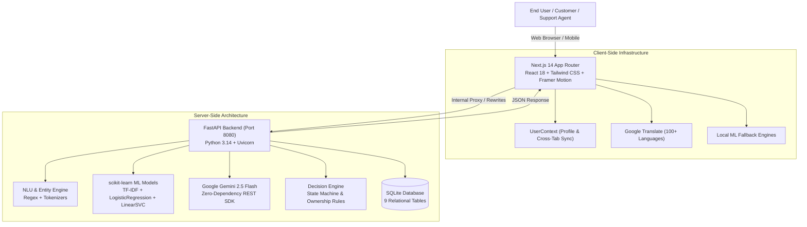
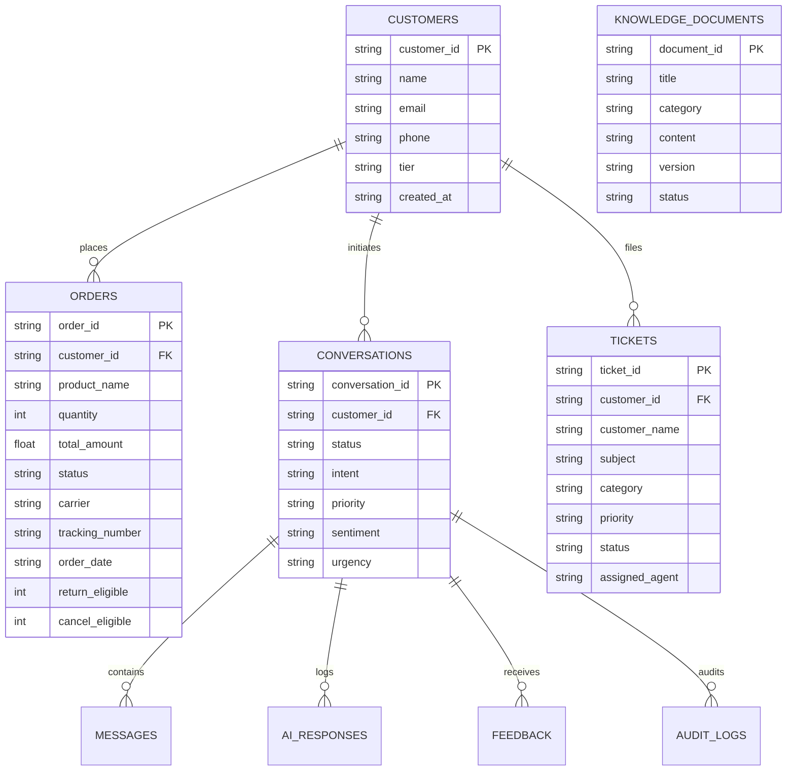

# Aegis AI Customer Support Agent — Complete Project Documentation

An enterprise-grade, autonomous machine learning customer operations SaaS platform combining deterministic business logic, local scikit-learn machine learning classifiers, and Google Gemini Generative AI.

---

## 1. Executive Summary & System Overview

Aegis AI is an end-to-end customer support automation platform designed for modern e-commerce and SaaS organizations. It handles customer inquiries autonomously, accurately predicts intent and ticket priority, manages return/cancellation workflows with strict security checks, provides multi-tone automated email drafting, conducts real-time sentiment inspection, and features voice recognition and full-website translation.



---

## 2. Complete Technology Stack

### A. Frontend Technologies
| Layer / Tool | Version | Purpose |
| :--- | :--- | :--- |
| **Next.js** | `14.2.15` | App Router architecture, Server & Client Components, API rewrite proxying |
| **React** | `18.3.1` | Component UI library, Hooks (`useState`, `useEffect`, `useRef`, `useContext`) |
| **TypeScript** | `5.6.3` | Type-safe interfaces, API payload models, compile-time verification |
| **Tailwind CSS** | `3.4.14` | Utility-first styling, glassmorphism design system, responsive layouts |
| **Framer Motion** | `11.11.11` | Micro-interactions, animated badges, tab transitions, slide-ins |
| **Lucide React** | `0.454.0` | Comprehensive iconography |
| **Recharts** | `2.13.0` | Analytics visualization, weekly emotion distributions, CSAT charts |
| **Canvas Confetti** | `1.9.4` | Gamified feedback celebrations on ticket resolutions & profile saves |
| **Web Speech API** | Native Browser | Client-side voice speech-to-text and text-to-speech audio synthesis |
| **Google Translate API** | v1 Web Element | Full DOM website translation across 100+ international languages |

### B. Backend Technologies
| Layer / Tool | Version | Purpose |
| :--- | :--- | :--- |
| **Python** | `3.14.0` | Core backend runtime execution environment |
| **FastAPI** | `0.141.1` | High-performance asynchronous REST API framework |
| **Uvicorn** | `0.52.1` | ASGI server running on `http://127.0.0.1:8080` |
| **Pydantic** | `2.13.4` | Data validation, request payload schemas, JSON serialization |
| **SQLite3** | `3.x` | Embedded relational database with ACID compliance (`support_system.db`) |
| **Joblib** | `1.5.3` | High-efficiency model serialization and in-memory deserialization |
| **Pillow (PIL)** | `12.3.0` | Multimodal image processing and OCR screenshot analysis |
| **PyTesseract** | `0.3.13` | Optical Character Recognition for diagnostic screenshots |

### C. Machine Learning & AI
| Component | Implementation | Model Architecture |
| :--- | :--- | :--- |
| **Intent Classifier** | scikit-learn | TF-IDF Vectorizer (512-dim) + Logistic Regression |
| **Ticket Categorizer** | scikit-learn | TF-IDF Vectorizer + Linear Support Vector Classifier (LinearSVC) |
| **Ticket Priority Engine** | scikit-learn | Multi-class LinearSVC with Urgency Feature Weighting |
| **Semantic Search / RAG** | scikit-learn / NumPy | TF-IDF Matrix with Cosine Similarity Vector Space Search |
| **Sentiment & Urgency** | Dual-Tier | Gemini 2.5 Flash + Rule-Augmented Scikit-Learn NLP Engine |
| **Generative LLM** | Google Gemini | `gemini-2.5-flash` via raw standard-library HTTP integration |

---

## 3. Database Architecture (SQLite Schema)

The persistent database is located at `backend/support_system.db`. It contains 9 relational tables:



1. **`customers`**: Stores profile information, contact info, and tier status (`Standard`, `Enterprise`).
2. **`orders`**: Full e-commerce orders catalog with delivery status, tracking IDs, and cancel/return eligibility flags.
3. **`knowledge_documents`**: Source-of-truth articles used for semantic search, auto-reply grounding, and LLM context.
4. **`conversations`**: Conversation session records, active state, assigned agents, and telemetry.
5. **`messages`**: Transcript history of user messages, bot replies, entity extractions, and timestamps.
6. **`ai_responses`**: AI audit trails including confidence score, grounded sources JSON, and retrieval ranking.
7. **`tickets`**: Triage support tickets with categories, priority tags (`P1` to `P4`), and assignment teams.
8. **`feedback`**: Customer CSAT ratings and text comments.
9. **`audit_logs`**: System audit trails for policy enforcement and security events.

---

## 4. Google Gemini Integration Architecture

The Gemini integration is implemented in [`backend/gemini_service.py`](file:///Users/nallamilliramacharanreddygmail.com/AI%20Customer%20Support%20Agent/backend/gemini_service.py) using Python's standard `urllib.request` and `json` libraries.

### Key Capabilities:
- **Zero Extra Dependencies**: Operates without external client libraries, avoiding version conflicts.
- **Thinking Token Compensation**: Configured with `max_tokens: 2048` to accommodate internal Gemini 2.5 Flash thinking tokens without truncating structured JSON outputs.
- **Resilient Fallbacks**: If the Gemini API key is unset or hits rate limits, deterministic business logic and local scikit-learn models automatically take over without downtime.
- **Secure Server-Side Configuration**: Key stored exclusively in `backend/.env` as `GEMINI_API_KEY`. Never exposed to client bundles.

### Operations Handled by Gemini:
1. **Contextual Chatbot Dialogue**: Enriches multi-turn conversation replies using grounded knowledge base articles.
2. **Multi-Tone Auto-Replies**: Drafts 3 distinct candidate answers:
   - *Professional*: Formal, structured, enterprise tone.
   - *Friendly*: Warm, conversational, empathetic tone.
   - *Concise*: Direct, bulleted, action-focused tone.
3. **Sentiment & Emotion Analysis**: Evaluates customer emotion, polarity, frustration, and urgency.
4. **Technical Root Cause Analysis**: Diagnoses error logs, provides probable causes, and generates step-by-step mitigation plans.
5. **Multimodal Diagnostic Vision**: Examines uploaded error screenshots, extracts OCR error text, and suggests engineering actions.
6. **Agent Handoff Summaries**: Synthesizes conversation history into a concise handover brief when escalating to a human specialist.

---

## 5. Core Feature Breakdown (Features 01 – 10)

### Feature 01: AI Conversational Chatbot
- **Path**: [`/dashboard/chatbot`](file:///Users/nallamilliramacharanreddygmail.com/AI%20Customer%20Support%20Agent/src/app/dashboard/chatbot/page.tsx)
- **Engine**: [`support_engine.py`](file:///Users/nallamilliramacharanreddygmail.com/AI%20Customer%20Support%20Agent/backend/support_engine.py), [`decision_engine.py`](file:///Users/nallamilliramacharanreddygmail.com/AI%20Customer%20Support%20Agent/backend/decision_engine.py)
- **Functionality**: Multi-turn finite state machine handling order tracking, order cancellations, returns, refunds, multilingual queries (6 languages), live support agent takeover mode, and real-time telemetry output.

### Feature 02: Ticket Classification and Triage
- **Path**: [`/dashboard/ticket-classification`](file:///Users/nallamilliramacharanreddygmail.com/AI%20Customer%20Support%20Agent/src/app/dashboard/ticket-classification/page.tsx)
- **Engine**: [`ticket_model.pkl`](file:///Users/nallamilliramacharanreddygmail.com/AI%20Customer%20Support%20Agent/backend/models/ticket_model.pkl) (LinearSVC)
- **Functionality**: Predicts ticket category (Order, Billing, Technical, Account) and priority (`P1 - Critical` to `P4 - Low`). Features automatic duplicate ticket detection against open SQLite tickets and auto-assigns tickets to relevant engineering teams.

### Feature 03: AI Auto-Replies
- **Path**: [`/dashboard/auto-replies`](file:///Users/nallamilliramacharanreddygmail.com/AI%20Customer%20Support%20Agent/src/app/dashboard/auto-replies/page.tsx)
- **Engine**: Gemini 2.5 Flash + Knowledge Document RAG
- **Functionality**: Generates grounded, policy-accurate candidate responses across 3 tones (Professional, Friendly, Concise) with interactive confidence ratings and an auto-dispatch mechanism that logs to the database.

### Feature 04: Knowledge Base & Semantic Search
- **Path**: [`/dashboard/knowledge-base`](file:///Users/nallamilliramacharanreddygmail.com/AI%20Customer%20Support%20Agent/src/app/dashboard/knowledge-base/page.tsx)
- **Engine**: TF-IDF Matrix Cosine Similarity + SQLite CRUD
- **Functionality**: Full article lifecycle management (Create, Read, Update, Delete) with on-demand vector index updates and sub-15ms vector space ranking.

### Feature 05: Sentiment & Urgency Detection
- **Path**: [`/dashboard/sentiment-analysis`](file:///Users/nallamilliramacharanreddygmail.com/AI%20Customer%20Support%20Agent/src/app/dashboard/sentiment-analysis/page.tsx)
- **Engine**: Gemini 2.5 Flash + Enhanced Scikit-Learn NLP Engine
- **Functionality**: Real-time emotion inspection (Positive, Neutral, Frustrated, Angry, Urgent), continuous polarity scores (`-1.0` to `+1.0`), automated CSAT predictions, and emotion probability breakdowns.

### Feature 06: Voice Support Engine
- **Path**: [`/dashboard/voice-support`](file:///Users/nallamilliramacharanreddygmail.com/AI%20Customer%20Support%20Agent/src/app/dashboard/voice-support/page.tsx)
- **Engine**: Web Speech API (`SpeechRecognition` & `SpeechSynthesis`) + Backend Pipeline
- **Functionality**: Live voice recording, real-time transcription, automated audio speech feedback from the AI agent, and historical call log persistence.

### Feature 07: Multimodal Issue Detection
- **Path**: Integrated in [`/dashboard`](file:///Users/nallamilliramacharanreddygmail.com/AI%20Customer%20Support%20Agent/src/app/dashboard/page.tsx)
- **Engine**: Gemini Vision / Tesseract OCR
- **Functionality**: Drag-and-drop image analysis for screenshots of software bugs, payment errors, and stack traces with OCR text extraction and engineering action recommendations.

### Feature 08: Root Cause Analysis Engine
- **Path**: Integrated in [`/dashboard`](file:///Users/nallamilliramacharanreddygmail.com/AI%20Customer%20Support%20Agent/src/app/dashboard/page.tsx)
- **Engine**: [`root_cause_model.pkl`](file:///Users/nallamilliramacharanreddygmail.com/AI%20Customer%20Support%20Agent/backend/models/root_cause_model.pkl) + Gemini Reasoning
- **Functionality**: Diagnoses the root failure point behind complex technical complaints and provides structured corrective actions.

### Feature 09: Personalized Customer History RAG
- **Path**: Integrated in [`/dashboard`](file:///Users/nallamilliramacharanreddygmail.com/AI%20Customer%20Support%20Agent/src/app/dashboard/page.tsx)
- **Engine**: SQLite Conversation Relational Queries
- **Functionality**: Correlates incoming queries with past customer tickets, orders, and interaction history to deliver personalized support context.

### Feature 10: Autonomous Policy Resolution
- **Path**: Integrated in [`/dashboard`](file:///Users/nallamilliramacharanreddygmail.com/AI%20Customer%20Support%20Agent/src/app/dashboard/page.tsx)
- **Engine**: [`decision_engine.py`](file:///Users/nallamilliramacharanreddygmail.com/AI%20Customer%20Support%20Agent/backend/decision_engine.py)
- **Functionality**: Enforces business policy rules (e.g., verifying return/cancellation eligibility windows, verifying customer ownership, preventing IDOR vulnerabilities) and executes actions automatically.

---

## 6. Recent Enhancements & UI Customizations

1. **Global Account Name Replication**:
   - Replaced all hardcoded agent names with a centralized [`UserContext`](file:///Users/nallamilliramacharanreddygmail.com/AI%20Customer%20Support%20Agent/src/context/UserContext.tsx) wrapped at the `RootLayout` level.
   - When you edit your profile name, it instantly updates across the Landing Header, Dashboard Overview banner, Top Navbar, Sidebar user card, Chatbot greeting/takeover, Admin panel, and Ticket records, with cross-tab `localStorage` synchronization.

2. **Full-Website Google Translate Integration**:
   - Created [`GoogleTranslate.tsx`](file:///Users/nallamilliramacharanreddygmail.com/AI%20Customer%20Support%20Agent/src/components/common/GoogleTranslate.tsx) with a Navbar language selector and a floating language toggle.
   - Translates all pages and dashboards into 100+ languages with quick-select options for English, Spanish, French, German, Hindi, Telugu, Chinese, Japanese, Arabic, and more.
   - Aggressively suppressed Google's top iframe banner via CSS and a DOM `MutationObserver` to ensure zero layout downshifts.

3. **Clean Chat Action Bar**:
   - Removed the unused smiley, paperclip, and sparkles buttons from the landing page chat card for a streamlined, minimalist interface.

---

## 7. Security & Environment Configuration

### Server-Side Configuration (`backend/.env`):
```ini
GEMINI_API_KEY=your_gemini_api_key_here
GEMINI_MODEL=gemini-2.5-flash
PORT=8080
HOST=127.0.0.1
```

### Client-Side Configuration (`.env.local`):
```ini
NEXT_PUBLIC_FASTAPI_URL=
```
*(Empty string routes API calls through Next.js internal rewrites to `http://127.0.0.1:8080`, shielding backend ports from direct browser exposure).*

### Security Protections:
- **No Hardcoded Credentials**: API keys are isolated to server-side environments and git-ignored.
- **IDOR Protection**: `OrderService` validates `customer_id` matches order ownership before allowing returns or cancellations.
- **Input Sanitization**: All queries undergo HTML escaping and regex sanitization via `validate_and_sanitize_input`.
- **CORS Restricted**: Backend CORS middleware is configured specifically for trusted local and tunneling hosts.

---

## 8. Directory & Key File Map

```text
├── src/
│   ├── app/
│   │   ├── layout.tsx                   # Global RootLayout with UserProvider & GoogleTranslate
│   │   ├── page.tsx                     # Landing page with LandingNavbar & HeroSection
│   │   ├── globals.css                  # Tailwind styles & Google Translate suppression rules
│   │   └── dashboard/
│   │       ├── page.tsx                 # Operations Control Hub (Features 7, 8, 9, 10)
│   │       ├── chatbot/page.tsx         # Feature 01: Conversational Chatbot
│   │       ├── ticket-classification/   # Feature 02: Ticket Classification & Triage
│   │       ├── auto-replies/page.tsx    # Feature 03: AI Auto-Replies
│   │       ├── knowledge-base/page.tsx  # Feature 04: Knowledge Base CRUD
│   │       ├── sentiment-analysis/      # Feature 05: Sentiment & Urgency Analyzer
│   │       ├── voice-support/page.tsx   # Feature 06: Voice Support Engine
│   │       ├── admin/page.tsx           # Admin Model Telemetry & Retraining
│   │       └── profile/page.tsx         # Account Profile & Settings
│   ├── components/
│   │   ├── common/GoogleTranslate.tsx   # Google Translate integration widget
│   │   ├── landing/LandingNavbar.tsx    # Landing page header with profile & translate
│   │   ├── layout/Navbar.tsx            # Dashboard top navigation bar
│   │   ├── layout/Sidebar.tsx           # Dashboard sidebar navigation
│   │   └── profile/EditProfileModal.tsx # Quick profile editing modal
│   ├── context/UserContext.tsx          # Global user state with cross-tab persistence
│   └── lib/api.ts                       # Typed API client interfacing with backend
│
├── backend/
│   ├── main.py                          # FastAPI application and route controllers
│   ├── gemini_service.py                # Zero-dependency Google Gemini integration
│   ├── nlu_engine.py                    # Natural language understanding & regex rules
│   ├── decision_engine.py               # Deterministic business logic & policy engine
│   ├── support_engine.py                # Conversational support workflow orchestration
│   ├── database.py                      # SQLite3 database connection and schema
│   ├── train_models.py                  # scikit-learn model training pipeline
│   ├── test_suite.py                    # 13 automated integration unit tests
│   ├── support_system.db                # SQLite database file
│   └── models/                          # Serialized .pkl machine learning models
│
├── package.json                         # Frontend dependencies and scripts
└── next.config.js                       # Next.js configuration and /api/* rewrites
```
